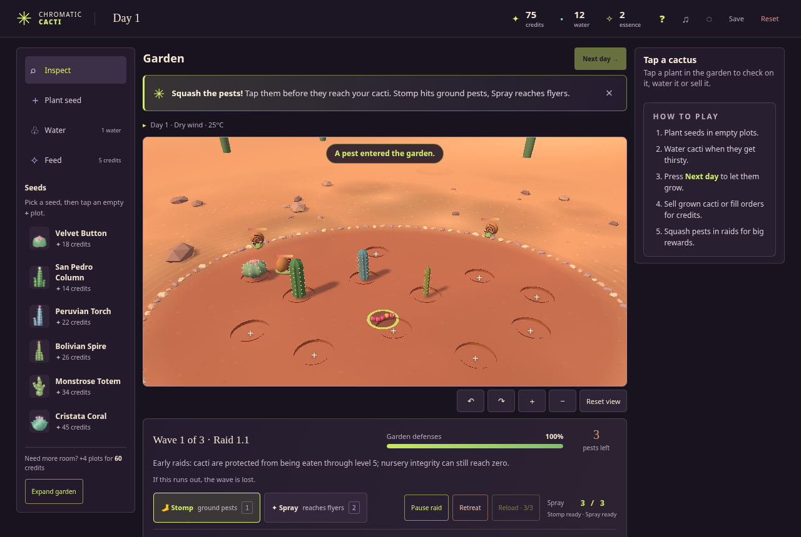

# Chromatic Cacti

A little 3D cactus garden game that runs in your web browser. Grow weird, colourful cacti, sell them, collect every kind, and squash the snails, bugs and birds that come to eat them.



## Playing it

You don't need to install anything.

- **Got a link?** Just open it.
- **Got a file called `index.html` or `chromatic-cacti.html`?** Double-click it. It opens in your web browser and the game starts.

It works in Chrome, Edge, Firefox and Safari, on a computer or a phone.

## How the game works

A tip at the top of the screen always tells you what to do next, so you can just follow that. The basics:

1. **Plant.** Pick a seed on the left, then tap an empty spot in the garden.
2. **Water.** When a cactus gets thirsty, pick **Water** and tap it.
3. **Next day.** Press **Next day** to let everything grow.
4. **Sell.** When a cactus is fully grown, tap it and press **Sell**. Spend the money on more seeds, a bigger garden and upgrades.
5. **Fight off pests.** Press **Start raid**, then tap the pests to squash them before they eat your cacti. Winning a raid pays well.

As you play you'll unlock more: orders from people who want a particular cactus (they pay extra), new colours and shapes for your cacti, friendly pink worms you can tap to collect and feed to your plants, and a collection of every cactus you've grown.

## Controls

| What | On a computer | On a phone |
|---|---|---|
| Look around | Click and drag the garden | Drag the garden |
| Zoom | Mouse wheel, or the **+** and **−** buttons | The **+** and **−** buttons |
| Stomp (squashes pests on the ground) | Press **1** | **Stomp** button at the bottom |
| Spray (also hits birds) | Press **2** | **Spray** button |
| Refill the spray | Press **R** | **Reload** button |

## Good to know

- **It saves by itself.** Your garden is kept in the browser you played in, on that device. Open it in a different browser or on another device and you start fresh. Clearing your browser's history and site data can wipe it too.
- **Sound is off at first.** Press the **♫** button at the top to turn it on.
- **Don't want the tips?** Press the **?** button at the top.
- **Reset** (top right) deletes your garden and starts over. It asks first.

## For whoever is hosting it

You need [Node.js](https://nodejs.org) installed. Then, in a terminal inside this folder:

```
npm install
npm run build
```

That makes the whole game as one file, `dist/index.html`. Send that file to people, or put it online:

- **Tailscale:** run `npm run share` and send people on your tailnet `http://<your-tailscale-ip>:5173`. The command prints the addresses.
- **playit.gg:** run `npm run share`, point a playit.gg tunnel at port 5173 and send the address it gives you.
- **GitHub Pages:** in this repo's Settings, go to Pages, set Source to "GitHub Actions", then run "Deploy to GitHub Pages" from the Actions tab.

For working on the game: `npm start` runs it at http://127.0.0.1:5173 and `npm test` runs the checks. It's plain JavaScript with [Three.js](https://threejs.org), and it needs no accounts or internet connection to play.

MIT licence, see [LICENSE](LICENSE). Three.js credits are in [THIRD_PARTY_NOTICES.md](THIRD_PARTY_NOTICES.md).
